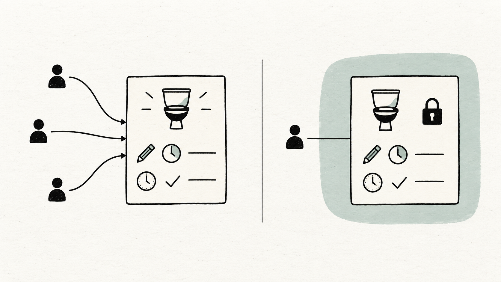

# Blog post

**Status:** Published October 16, 2026.

**Owner:** Zheli Chen

**Published article:** [Building Restroom Ready: Making a restroom pin useful](https://medium.com/@zc2856/building-restroom-ready-making-a-restroom-pin-useful-f690320d261e)

**Placement:** Medium, account @zc2856 (display name Zc). Zheli published the article; the publication confirmation was observed. The text below is the repository source.

---

# Building Restroom Ready: Making a restroom pin useful

*A location gets you to a building. Entry rules, the route inside, and the age of a report help you decide whether to go there.*

*AI-generated illustration: a location connects to several separate questions about using a restroom.*

Suppose a map shows a restroom two blocks away. Before walking over, you may still want to know whether you need to buy something, whether the restroom is downstairs, or whether anyone has recently checked the code on the door. The distance answers one part of the decision. The remaining questions can determine whether the trip works at all.

We're building Restroom Ready, a web app for finding restrooms in NYC, around those remaining questions. The design problem is how to bring together information that comes from different sources, changes at different speeds, and sometimes needs to stay private. This article was written with AI assistance using our project documentation.

## Separate the decisions a person has to make

Consider a café that lets customers use its restroom but keeps it down a flight of stairs. Knowing the purchase rule helps someone decide whether they can enter. Knowing about the stairs helps them decide whether they can reach the restroom. A single label would leave part of that decision unexplained.

Our listing structure keeps entry, route, and condition details separate. Purchase requirements belong with entry information. Floors and stairs describe the route inside. Cleanliness ratings add another signal, alongside whatever condition details have actually been reported.

The same separation matters when information is missing. Our city directory contains 1,064 locations imported from the [NYC Open Data Public Restrooms dataset](https://data.cityofnewyork.us/City-Government/Public-Restrooms/i7jb-7jku), after merging two duplicate rows. That provides a useful starting collection. It leaves many restroom-specific questions unanswered: purchase rules, internal stairs, and cleanliness are not structured fields in the source we imported.

Those gaps remain visible. “Not reported” gives someone a reason to check further. Filling the space with a reassuring default would remove information they need to make the choice.

## Give dates a specific meaning

A directory download, a visitor report, and a successful passcode check each describe a different event. Combining them under one “updated” label can make old information appear newly confirmed.

Our imported city snapshot illustrates the distinction. We retrieved it in October 2026, while the source's data-update timestamp was June 2025. The retrieval date tells us when we obtained the file. It says nothing about when someone last checked an individual restroom.

Passcodes make the consequence especially clear. Suppose a visitor confirms a code on Monday and its owner changes it on Tuesday. Monday's successful use applies to the earlier code. Carrying that verification forward would attach evidence to a value nobody has checked.

In Restroom Ready, a code edit starts a new version and clears its previous verification. The interface shows “Code updated” separately from “Last verified.” A successful-use report is tied to the code version the visitor checked.

Ratings need their own interpretation too. We show an average, a count, and when the aggregate changed. That timestamp can change when someone edits or removes a vote; it does not establish when every contributing visitor was at the restroom. The Clean filter uses an average of at least four stars and excludes unrated places. An unrated place remains unknown.

## Put private codes behind an ownership boundary

*AI-generated illustration: public and private code reports keep separate visibility settings and timestamps.*

A person might want to keep a restroom code for their next visit without sharing it. That makes visibility part of the data model.

Codes start as “Only me.” Saving one privately also adds the location to that person's saved places. In the full finder, Google Sign-in identifies the owner, and Firestore rules restrict access to the private record. Choosing to share creates a separate public record. Only the submitter can change the code or its visibility. Other signed-in visitors can record successful use of a public code.

This lets a public code and someone's private code coexist. Each keeps its own update and verification timestamps. Sharing one report grants no permission to change somebody else's code or visibility, and a more recent submission does not automatically settle a disagreement.

The distinction affects what the interface should say. It can show which code is public, which belongs to you, and when each was checked. It cannot establish that either will still work when you arrive.

## Make the interaction easy to try

The full directory remains behind team access while we develop it. The public demo gives visitors a way to try the interactions without creating an account or writing to the live database.

It starts with one Target Herald Square example. You can try the filters, slide across the stars to choose a rating, save a place, add a sample location, and compare public and private passcode reports. The venue address supplies context; the conditions, ratings, codes, and checks are sample data. Changes stay in the page's memory and reset on reload.

That boundary makes feedback more specific. Someone can point to a confusing label or an unexpected filter result. The example still cannot tell them whether Target's restroom is usable today.

## What we need to learn next

The next question is whether these distinctions help people make a choice. Can someone tell an entry restriction from a route problem? Does the date explain what was checked? Is it clear which code stays private?

We also need genuine observations to fill the gaps in the directory. More locations alone will not answer a missing question about stairs or supplies. The useful next contribution may be one specific detail, with a source and an observation date.

Restroom Ready is still in development. The public demo shows the decisions we are working on, and the landing page has an optional email signup for updates.

[See how we're approaching restroom conditions and try the demo](https://nyc.imfinethanku.me/conditions/?utm_source=blog&utm_medium=organic_content&utm_campaign=hw5&utm_content=restroom_checklist).

---

## Posting notes — not part of the article

The article above is the repository source for the [published Medium story](https://medium.com/@zc2856/building-restroom-ready-making-a-restroom-pin-useful-f690320d261e), part of the current Facebook, X, and blog campaign. The final CTA uses the full conditions-page UTM link. Image provenance and full prompts are in [the illustration record](blog-assets/prompts.md). Publication is recorded in [the demand strategy](../demand_strategy.md); traffic and signup results have not yet been measured.
